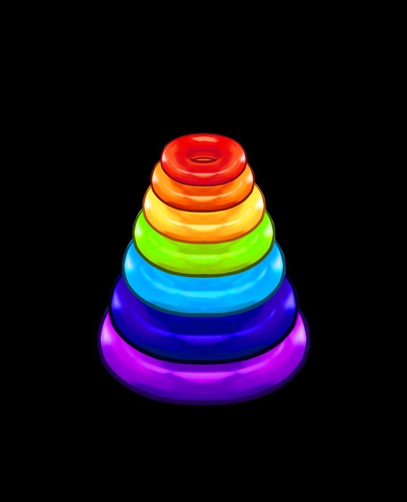

<div align="center">

# 🌈 Rainbow Pyramids · Радужные пирамидки

**A glossy 3D ring-sorting puzzle made in Godot 4. Play in the browser, on Android or on Windows.**

**[▶ Play online](https://severance.lol/7/)** · [Android APK](https://severance.lol/7/RainbowPyramids.apk)



</div>

## The game

Neon rings in seven colours are mixed up on the pegs. Sort them so that every colour stands on its own
peg as a perfect pyramid: biggest ring at the bottom, smallest on top.

- Tap a peg to pick up its **top** ring, then tap another peg to drop it there.
- A ring can go onto an **empty** peg, or onto a **bigger ring of the same colour**.
- A peg holds only so many rings.
- Finish within the target number of moves for three stars.

50 hand-checked levels: every one is proven solvable by a solver, and its target is the shortest
solution found. Boards grow from 2 colours × 3 sizes to 7 colours × 5 sizes on 10 pegs.

**Helpers:** unlimited undo, restart, and a hint button. The hint follows the known solution, or
asks the in-game solver when you've gone your own way (or tells you to undo when you're stuck).

**Juice:** rings fly in arcs with a tilt, squash when they land, and the rings below wobble.
A finished pyramid plays a rising chime, with a fountain of sparks, a glowing halo and a gold tip.
Winning a level throws confetti and makes every ring dance, then the stars pop in one by one.
CC0 sound effects and music, a title screen with a breathing pyramid and orbiting rings you can poke.

| Action | Mouse / touch | Keyboard |
|---|---|---|
| Pick up / drop | tap a peg | `1`–`9` |
| Undo | ↶ button | `Z` / `Backspace` |
| Restart | ⟳ button | `R` |
| Hint | 💡 button | `H` |

## Run locally

Godot 4.7 (Compatibility renderer). Open the folder in Godot and press Play, or:

```
godot --path .
godot --path . -- --level 12      # jump to a level
godot --path . -- --autotest      # self-test, screenshots in renders/game/
```

## How it's made

- `scripts/puzzle.gd` — the rules and a weighted A* solver (used for hints).
- `scripts/board.gd` — the 3D board: procedural torus rings with a candy shader and an ink outline,
  pegs, picking, every animation and particle effect.
- `scripts/main.gd` — flow, camera framing for any screen shape, UI built in code, the autotest.
- `tools/gen_levels.py` — makes `assets/levels/levels.json`: random deals, solver-checked, par = shortest solution.
- Concept art in `concept/` was supplied by the project owner; sounds are CC0, see [assets/CREDITS.md](assets/CREDITS.md).
